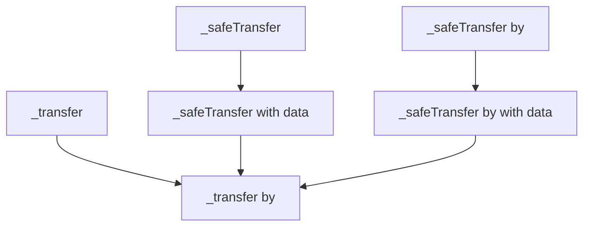
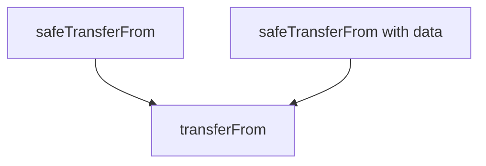
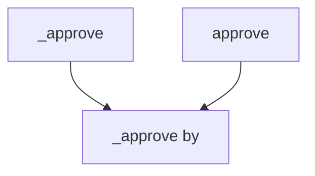

logo: A pixelated green frog character (Pepe) wearing a black hat and jacket with a gold chain, set against an orange circular background with a white web-like pattern.

# Solady ERC721 Security Review

Part of OpenSense Solwaifu Initiative

Shung

License: CC BY-SA 3.0

July 8, 2023

---

# Table of Contents

**1 Introduction** **1**

**2 Scope** **1**

**3 Custom Storage Layout Review** **1**

**4 Manual Memory Operations Review** **2**

**5 Security Review Findings** **3**
5.1 No underflow check exists when decrementing user balance  3
5.2 Precompile `0x04` might be missing on some chains  3
5.3 Internal functions are not reused  4
5.4 Treating zero address as a special condition in `by` argument  5
5.5 External functions are marked payable  6
5.6 No event is emitted for auxiliary and extra data changes  7
5.7 Typographical errors in the comments  7
5.8 Local variable can be set after the conditional revert  8
5.9 Master slot might be unnecessary  10
5.10 `mstore` can be avoided by passing the length to identity precompile  11

**6 Conclusion** **13**

i


---

Solady ERC721 Security Review

## 1 Introduction

This report is part of OpenSense’s Operation Solwaifu initiative to community audit Solady contracts. As part of the initiative, I have volunteered to review the ERC721 contract.

The review took place between June 26, 2023 and July 1, 2023. Over the course of the review I have not found any significant issues.

**Disclaimer:** This security report is not a guarantee that the system has no other bugs. This is a best effort review of the system by a single person conducted within a limited time period. All the diffs and code samples provided are for demonstration purposes only, are not tested, and have no security guarantees.

**About Me - shung:** I am an independent smart contract auditor with deep knowledge of EVM, Solidity, and decentralized finance. I have a long track record of developing safe and secure smart contracts at Pangolin. I am also an NFT and crypto enjoyer. If you’re in need of smart contract development or auditing services, find me on [Twitter](https://twitter.com/shunduquar).

## 2 Scope

The review covered the smart contract code hosted at the following repository, version tag, commit hash, and contract names:

**Repository:** [https://github.com/Vectorized/solady](https://github.com/Vectorized/solady)
**Version Tag:** v0.0.107
**Commit Hash:** 7175c21f95255dc7711ce84cc32080a41864abd6
**Contract Names:**

```
src/
└── tokens/
    └── ERC721.sol
```

## 3 Custom Storage Layout Review

Solady ERC721 implements a custom storage layout. This storage layout is secure and does not clash within itself or with any native Solidity storage slot. The storage slots are always accessed and written correctly in the contract.

The storage layout is defined in the comments.

1

---

Solady ERC721 Security Review

79 The ownership data slot of `id` is given by:
80 ```
81      mstore(0x00, id)
82      mstore(0x1c, _ERC721_MASTER_SLOT_SEED)
83      let ownershipSlot := add(id, add(id, keccak256(0x00, 0x20)))
84 ```
85 Bits Layout:
86 - [0..159] `addr`
87 - [160..223] `extraData`
88
89 The approved address slot is given by: `add(1, ownershipSlot)`.
90
91 See: https://notes.ethereum.org/%40vbuterin/verkle_tree_eip
92
93 The balance slot of `owner` is given by:
94 ```
95      mstore(0x1c, _ERC721_MASTER_SLOT_SEED)
96      mstore(0x00, owner)
97      let balanceSlot := keccak256(0x0c, 0x1c)
98 ```
99 Bits Layout:
100 - [0..31] `balance`
101 - [32..225] `aux`
102
103 The `operator` approval slot of `owner` is given by:
104 ```
105      mstore(0x1c, or(_ERC721_MASTER_SLOT_SEED, operator))
106      mstore(0x00, owner)
107      let operatorApprovalSlot := keccak256(0x0c, 0x30)
108 ```

Code 1: ERC721.sol#L79

## 4 Manual Memory Operations Review

Solady ERC721 almost always manually reads and writes from the memory. With the exception of _checkOnERC721Received function, memory is only written to the first two 32 byte chunks. In _checkOnERC721Received, memory is written from the safe memory pointer onwards. There is no memory read operation that reads an unknown byte. All memory reads are made to the bytes that are written in the same assembly block. All in all, memory operations in the contract have no errors.

2


---

Solady ERC721 Security Review

## 5 Security Review Findings

### 5.1 No underflow check exists when decrementing user balance

**Severity:** Low risk
**Context:** [ERC721.sol#L287-L288](https://github.com/Vectorized/solady/blob/7175c21f95255dc7711ce84cc32080a41864abd6/src/tokens/ERC721.sol#L287-L288), [ERC721.sol#L555-L556](https://github.com/Vectorized/solady/blob/7175c21f95255dc7711ce84cc32080a41864abd6/src/tokens/ERC721.sol#L555-L556), [ERC721.sol#L750-L751](https://github.com/Vectorized/solady/blob/7175c21f95255dc7711ce84cc32080a41864abd6/src/tokens/ERC721.sol#L750-L751)

**Description**

There is no underflow checks when decrementing the `from` balance during a transfer or burn. Although within the constraints of Solady ERC721 the underflow is impossible, an inheriting contract can invalidate this assumption.

**Recommendation**

Consider either checking for underflow or documenting this feature.

**Response**

Vectorized (Solady): Added a cautionary comment to remind developers to never violate the ERC721 invariant when overriding. As long as the user balance is always equal to their number of ownership slots, underflow is not possible.

### 5.2 Precompile 0x04 might be missing on some chains

**Severity:** Low risk
**Context:** [ERC721.sol#L860](https://github.com/Vectorized/solady/blob/7175c21f95255dc7711ce84cc32080a41864abd6/src/tokens/ERC721.sol#L860)

**Description**

In `_checkOnERC721Received` internal function, there is a call made to the identity precompile at address 0x04. This precompile does not exist on zkSync, and might also be missing on other chains. Moreover, `_checkOnERC721Received` function lacks any checks to ensure the returned value from the precompile is valid. This silent failure can lead to user provided safe transfer data to be passed incorrectly to the NFT recipient.

3


---

Solady ERC721 Security Review

**Recommendation**

Consider either using the standard opcodes for memory manipulation or documenting this feature.

**Response**

Vectorized (Solady): Edited README in [a1ae24c](https://github.com/Vectorized/solady/commit/a1ae24ca6824913b26077e7e99264e36019c6824) to contain a section on EVM compatibility.

## 5.3 Internal functions are not reused

**Severity:** Informational

**Context:** [ERC721.sol#616-618](https://github.com/Vectorized/solady/blob/7175c21f95255dc7711ce84cc32080a41864abd6/src/tokens/ERC721.sol#616-618), [ERC721.sol#606-613](https://github.com/Vectorized/solady/blob/7175c21f95255dc7711ce84cc32080a41864abd6/src/tokens/ERC721.sol#606-613), [ERC721.sol#572-602](https://github.com/Vectorized/solady/blob/7175c21f95255dc7711ce84cc32080a41864abd6/src/tokens/ERC721.sol#572-602), [ERC721.sol#796-798](https://github.com/Vectorized/solady/blob/7175c21f95255dc7711ce84cc32080a41864abd6/src/tokens/ERC721.sol#796-798), [ERC721.sol#813-819](https://github.com/Vectorized/solady/blob/7175c21f95255dc7711ce84cc32080a41864abd6/src/tokens/ERC721.sol#813-819), [ERC721.sol#771-773](https://github.com/Vectorized/solady/blob/7175c21f95255dc7711ce84cc32080a41864abd6/src/tokens/ERC721.sol#771-773), [ERC721.sol#787-793](https://github.com/Vectorized/solady/blob/7175c21f95255dc7711ce84cc32080a41864abd6/src/tokens/ERC721.sol#787-793), [ERC721.sol#664-680](https://github.com/Vectorized/solady/blob/7175c21f95255dc7711ce84cc32080a41864abd6/src/tokens/ERC721.sol#664-680), [ERC721.sol#702-768](https://github.com/Vectorized/solady/blob/7175c21f95255dc7711ce84cc32080a41864abd6/src/tokens/ERC721.sol#702-768), [ERC721.sol#687-689](https://github.com/Vectorized/solady/blob/7175c21f95255dc7711ce84cc32080a41864abd6/src/tokens/ERC721.sol#687-689)

**Description**

There are internal functions added mostly for the convenience of parent contract. These functions are not reused in relevant external functions. This can lead to blunders where a parent contract overrides an internal function with the expectation that the behaviour of the external function would change.

In the below call graph of internal transfer functions, the transfer logic is at `_transfer by` function. However, none of the internal functions below in the graph are used by `safeTransferFrom`, `safeTranferFrom` with data, or `transferFrom`.



Figure 1: Call graph of internal transfer functions

4

---

Solady ERC721 Security Review


Figure 2: Call graph of external transfer functions

The same design is used for approval functions. An inheriting contract can override `_approve` which would have no effect on `approve`.


Figure 3: Call graph of approve functions

Similarly, `getApproved` and `setApprovalForAll` re-implements the logic of `_getApproved` and `_setApprovalForAll`, respectively.

Another example is `_isApprovedOrOwner` and `_ownerOf` functions, which are not used for access control in functions like `transferFrom` and `approve`. A deveoper might blunder by overriding `_isApprovedOrOwner` function with the expectation that it is reused in all relevant functions. All in all, this design can subvert developer expectations and lead to mistakes.

**Recommendation**

Consider thoroughly documenting this design.

**Response**

Vectorized (Solady): Added a cautionary comment mentioning that code duplicated and manually inlined for performance, and overriding internal functions may not affect the behavior of external functions.

## 5.4 Treating zero address as a special condition in `by` argument

**Severity:** Informational

5

---

Solady ERC721 Security Review

**Context:** [ERC721.sol#L517](https://github.com/Vectorized/solady/blob/7175c21f95255dc7711ce84cc32080a41864abd6/src/tokens/ERC721.sol#L517), [ERC721.sol#L628](https://github.com/Vectorized/solady/blob/7175c21f95255dc7711ce84cc32080a41864abd6/src/tokens/ERC721.sol#L628), [ERC721.sol#L664](https://github.com/Vectorized/solady/blob/7175c21f95255dc7711ce84cc32080a41864abd6/src/tokens/ERC721.sol#L664), [ERC721.sol#L702](https://github.com/Vectorized/solady/blob/7175c21f95255dc7711ce84cc32080a41864abd6/src/tokens/ERC721.sol#L702), [ERC721.sol#L796](https://github.com/Vectorized/solady/blob/7175c21f95255dc7711ce84cc32080a41864abd6/src/tokens/ERC721.sol#L796), [ERC721.sol#L813](https://github.com/Vectorized/solady/blob/7175c21f95255dc7711ce84cc32080a41864abd6/src/tokens/ERC721.sol#L813)

### Description

Many internal functions take a `by` argument. Inheriting contract can pass `msg.sender`, `address(0)`, or another address as `by`. If `address(0)` is passed, it is treated as a boolean flag, and the function executes without checking for access control. For that purpose, to be more explicit a boolean can be used. Otherwise, these functions appear more prone to developer errors.

### Recommendation

Consider using boolean or thoroughly documenting what to pass as `by`.

### Response

Vectorized (Solady): This is intentional to reduce the number of stack operations for performance.

## 5.5 External functions are marked payable

**Severity:** Informational

**Context:** [ERC721.sol#L190](https://github.com/Vectorized/solady/blob/7175c21f95255dc7711ce84cc32080a41864abd6/src/tokens/ERC721.sol#L190), [ERC721.sol#L241](https://github.com/Vectorized/solady/blob/7175c21f95255dc7711ce84cc32080a41864abd6/src/tokens/ERC721.sol#L241), [ERC721.sol#L308](https://github.com/Vectorized/solady/blob/7175c21f95255dc7711ce84cc32080a41864abd6/src/tokens/ERC721.sol#L308), [ERC721.sol#L325-L329](https://github.com/Vectorized/solady/blob/7175c21f95255dc7711ce84cc32080a41864abd6/src/tokens/ERC721.sol#L325-L329)

### Description

Four external functions in the contract are marked payable. Although this complies with [ERC-721 standard](https://eips.ethereum.org/EIPS/eip-721), user mistakes can lead to locked ether in the contract.

### Recommendation

Consider either removing payable modifier from those functions or documenting this feature.

### Response

Addressed by an inline comment in [PR 496](https://github.com/Vectorized/solady/pull/496/files#diff-2a1f0c78c338ce20b02482766a691eff70cd654a314c24fb1ba1806406e31b8cR14).

6


---

Solady ERC721 Security Review

## 5.6 No event is emitted for auxiliary and extra data changes

**Severity:** Informational
**Context:** [ERC721.sol#L387-L399](https://github.com/Vectorized/solady/blob/7175c21f95255dc7711ce84cc32080a41864abd6/src/tokens/ERC721.sol#L387-L399), [ERC721.sol#L413-L425](https://github.com/Vectorized/solady/blob/7175c21f95255dc7711ce84cc32080a41864abd6/src/tokens/ERC721.sol#L413-L425)

### Description

`_setAux` and `_setExtraData` internal functions update the extra data attached to an address and a token respectively. Although these functions perform important state changes, no event is emitted.

### Recommendation

Consider either adding events or documenting that parent contracts using these functions should emit appropriate events.

### Response

Vectorized (Solady): This is intentional for performance. A comment is added to remind users to emit their own events if needed.

## 5.7 Typographical errors in the comments

**Severity:** Informational
**Context:** [ERC721.sol#L568](https://github.com/Vectorized/solady/blob/7175c21f95255dc7711ce84cc32080a41864abd6/src/tokens/ERC721.sol#L568), [ERC721.sol#L596](https://github.com/Vectorized/solady/blob/7175c21f95255dc7711ce84cc32080a41864abd6/src/tokens/ERC721.sol#L596), [ERC721.sol#L663](https://github.com/Vectorized/solady/blob/7175c21f95255dc7711ce84cc32080a41864abd6/src/tokens/ERC721.sol#L663)

### Description

The *managed* should be *manage*:

Code 2: ERC721.sol#L568. Line 568: /// @dev Returns whether `account` is the owner of token `id`, or is approved to managed it.

The end of sentence should have a period:

7


---

Solady ERC721 Security Review

```solidity
596     // Check if `account` is approved to
```
Code 3: [ERC721.sol#L596](https://github.com/Vectorized/solady/blob/7175c21f95255dc7711ce84cc32080a41864abd6/src/tokens/ERC721.sol#L596)

The *a* should be an *an*:

```solidity
663     /// Emits a {ApprovalForAll} event.
```
Code 4: [ERC721.sol#L663](https://github.com/Vectorized/solady/blob/7175c21f95255dc7711ce84cc32080a41864abd6/src/tokens/ERC721.sol#L663)

Two forward slashes should be three forward slashes:

```solidity
86     // - [0..159] `addr`
87     // - [160..223] `extraData`
```
Code 5: [ERC721.sol#L86-L87](https://github.com/Vectorized/solady/blob/7175c21f95255dc7711ce84cc32080a41864abd6/src/tokens/ERC721.sol#L86-L87)

**Recommendation**

Consider fixing the typos.

**Response**

Vectorized (Solady): Addressed in this PR [URL].

### 5.8 Local variable can be set after the conditional revert

**Severity:** Execution cost optimization
**Context:** [ERC721.sol#L580-L592](https://github.com/Vectorized/solady/blob/7175c21f95255dc7711ce84cc32080a41864abd6/src/tokens/ERC721.sol#L580-L592)

**Description**

In `_isApprovedOrOwner` view function, the return value is initially set to 1, and then later conditionally set to 0. However, there is a potential revert in between if token does not exist. Defining result as 1 after the `iszero(owner)` check can save gas on reverting case.

8


---

Solady ERC721 Security Review

```solidity
579 assembly {
580   result := 1
581   // Clear the upper 96 bits.
582   account := shr(96, shl(96, account))
583   // Load the ownership data.
584   mstore(0x00, id)
585   mstore(0x1c, or(_ERC721_MASTER_SLOT_SEED, account))
586   let ownershipSlot := add(id, add(id, keccak256(0x00, 0x20)))
587   let owner := shr(96, shl(96, sload(ownershipSlot)))
588   // Revert if the token does not exist.
589   if iszero(owner) {
590     mstore(0x00, 0xceea21b6) // `TokenDoesNotExist()`.
591     revert(0x1c, 0x04)
592   }
593   // Check if `account` is the `owner`.
594   if iszero(eq(account, owner)) {
595     mstore(0x00, owner)
596     // Check if `account` is approved to
597     if iszero(sload(keccak256(0x0c, 0x30))) {
598       result := eq(account, sload(add(1, ownershipSlot)))
599     }
600   }
601 }
```

Code 6: [ERC721.sol#L579-L601](https://github.com/Vectorized/solady/blob/7175c21f95255dc7711ce84cc32080a41864abd6/src/tokens/ERC721.sol#L579-L601)

### Recommendation

Consider moving the line with `result := 1` below the token existence check.

### Response

**Vectorized (Solady):** This is intentional to aid the compiler to produce more optimized bytecode. At the beginning of the function, the compiler implicitly generates a `result := 0`. Placing `result := 1` at the top of the function places it right after the `result := 0`. The bytecode locality helps to compiler to detect that it is unnecessary and remove the `result := 0`.

9

---

Solady ERC721 Security Review

## 5.9 Master slot might be unnecessary

**Severity:** Execution cost optimization

**Context:** [ERC721.sol#L82](https://github.com/Vectorized/solady/blob/7175c21f95255dc7711ce84cc32080a41864abd6/src/tokens/ERC721.sol#L82), [ERC721.sol#L95](https://github.com/Vectorized/solady/blob/7175c21f95255dc7711ce84cc32080a41864abd6/src/tokens/ERC721.sol#L95), [ERC721.sol#L105](https://github.com/Vectorized/solady/blob/7175c21f95255dc7711ce84cc32080a41864abd6/src/tokens/ERC721.sol#L105)

### Description

All custom storage slots are derived using a master slot seed constant. The purpose of the seed is not clear. If it is to prevent slot collision, it would be sufficient to hash different lengths of data than 32 bytes. This would reduce the access cost of the storage slots.

### Recommendation

Consider the below storage layout.

1 The ownership data slot of `id` can be given by:
2
3 ```
4      mstore(0x00, id)
5      let ownershipSlot := add(id, add(id, keccak256(0x00, 0x1f)))
6 ```
7
8 The approved address slot can be given by: `add(1, ownershipSlot)`.
9
10 The balance slot of `owner` can be given by:
11
12 ```
13      mstore(0x00, owner)
14      let balanceSlot := keccak256(0x0c, 0x14)
15 ```
16
17 The `operator` approval slot of `owner` can be given by:
18
19 ```
20      mstore(0x14, operator)
21      mstore(0x00, owner)
22      let operatorApprovalSlot := keccak256(0x0c, 0x28)
23 ```

### Response

For upgrade compatibility, we prefer not to change our storage layout unless there is a bug.

10


---

Solady ERC721 Security Review

## 5.10 mstore can be avoided by passing the length to identity precompile

**Severity:** Execution cost optimization
**Context:** [ERC721.sol#L858-L860](https://github.com/Vectorized/solady/blob/7175c21f95255dc7711ce84cc32080a41864abd6/src/tokens/ERC721.sol#L858-L860)

### Description

`_checkOnERC721Received` function calls the identity precompile with the assumption that the precompile exists. I mentioned in a previous finding that this can be dangerous. But if Solady team wants to preserve the current behaviour, it is possible to use the precompile more efficiently.

The function first pushes `data` length to the stack, and copies it to the memory. This is done before calling the identity precompile. It instead possible to use the returndata from identity call to store all the parts of the data (including its length) in the same call.

11


---

Solady ERC721 Security Review

```solidity
849  assembly {
850    // Prepare the calldata.
851    let m := mload(0x40)
852    let onERC721ReceivedSelector := 0x150b7a02
853    mstore(m, onERC721ReceivedSelector)
854    mstore(add(m, 0x20), caller()) // The `operator`, which is always
       ↪ `msg.sender`.
855    mstore(add(m, 0x40), shr(96, shl(96, from)))
856    mstore(add(m, 0x60), id)
857    mstore(add(m, 0x80), 0x80)
858    let n := mload(data)
859    <mark>mstore(add(m, 0xa0), n)</mark>
860    if n { pop(staticcall(gas(), 4, add(data, 0x20), n, add(m, 0xc0), n)) }
861    // Revert if the call reverts.
862    if iszero(call(gas(), to, 0, add(m, 0x1c), add(n, 0xa4), m, 0x20)) {
863      if returndatasize() {
864        // Bubble up the revert if the call reverts.
865        returndatacopy(0x00, 0x00, returndatasize())
866        revert(0x00, returndatasize())
867      }
868      mstore(m, 0)
869    }
870    // Load the returndata and compare it.
871    if iszero(eq(mload(m), shl(224, onERC721ReceivedSelector))) {
872      mstore(0x00, 0xd1a57ed6) //
         ↪ `TransferToNonERC721ReceiverImplementer()`.
873      revert(0x1c, 0x04)
874    }
875  }
```

Code 7: ERC721.sol#L849-L875

## Recommendation

Consider the below diff.

```diff
1  diff --git a/src/tokens/ERC721.sol b/src/tokens/ERC721.sol
2  index 042c4c3..34a6ce2 100644
3  --- a/src/tokens/ERC721.sol
4  +++ b/src/tokens/ERC721.sol
5  @@ -856,8 +856,7 @@ abstract contract ERC721 {
```

12


---

Solady ERC721 Security Review

```
6              mstore(add(m, 0x60), id)
7              mstore(add(m, 0x80), 0x80)
8              let n := mload(data)
9      -       mstore(add(m, 0xa0), n)
10     -       if n { pop(staticcall(gas(), 4, add(data, 0x20), n, add(m,
       ↪  0xc0), n)) }
11     +       if n { pop(staticcall(gas(), 4, data, add(n, 0x20), add(m,
       ↪  0xa0), add(n, 0x20))) }
12             // Revert if the call reverts.
13             if iszero(call(gas(), to, 0, add(m, 0x1c), add(n, 0xa4), m,
       ↪          0x20)) {
14                        if returndatasize() {
```

**Response**

Vectorized (Solady): The `mstore` is still required, as we cannot assume that the memory is zeroized. An inheriting contract may perform operations that can leave regions in the free memory in a non-zero state.

## 6 Conclusion

I have found Solady ERC721 to be sound and secure by itself. Most of the concerns raised were regarding potential misuses. With the exception of finding 5.4, these were all addressed through documentation and inline comments in PRs [495](https://github.com/Vectorized/solady/pull/495) and [496](https://github.com/Vectorized/solady/pull/496).

13
